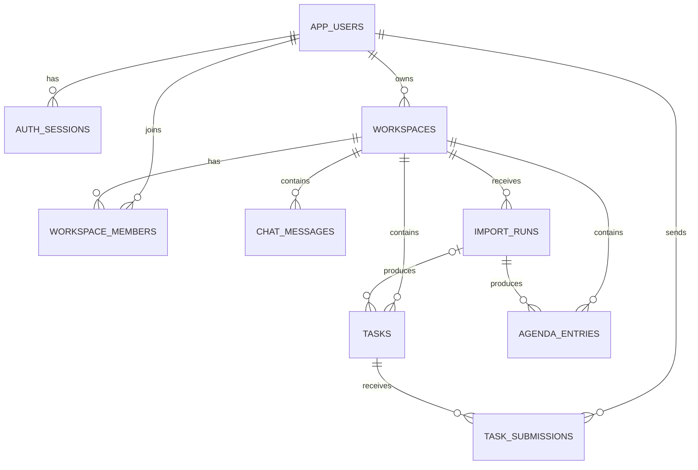

# Entity Guide — Remiyu Backend

Dokumen ini menjelaskan struktur database backend Remiyu: tabel yang tersedia, kolom penting, relasi, constraint, dan bagaimana data mengalir di antara tabel. Sumber kebenarannya adalah Flyway migration:

- `src/main/resources/db/migration/V1__initial_schema.sql`
- `src/main/resources/db/migration/V2__task_submissions.sql`

## Konvensi

- Primary key seluruh entity domain memakai `UUID`.
- Waktu disimpan sebagai `TIMESTAMP WITH TIME ZONE`.
- Foreign key menjaga hubungan data antartabel.
- Data sensitif seperti `password_hash`, `token_hash`, dan isi file submission tidak pernah dikirim dalam response API.

## Skema relasi



Ringkasnya:

```text
User
├─ memiliki banyak sesi login
├─ dapat memiliki banyak Workspace sebagai owner
├─ dapat menjadi anggota banyak Workspace
└─ dapat mengirim banyak hasil tugas

Workspace
├─ memiliki banyak anggota
├─ memiliki banyak pesan sumber dari import chat
├─ memiliki banyak riwayat import
├─ memiliki banyak tugas
└─ memiliki banyak agenda

Import
├─ dapat menghasilkan banyak tugas draft
└─ dapat menghasilkan banyak agenda draft

Task
└─ dapat memiliki banyak hasil/bukti penyelesaian
```

## 1. `app_users`

Menyimpan akun user Remiyu.

| Kolom | Tipe | Constraint | Fungsi |
|---|---|---|---|
| `id` | UUID | PK | Identitas unik user |
| `name` | VARCHAR(100) | NOT NULL | Nama user |
| `email` | VARCHAR(254) | NOT NULL, UNIQUE | Email untuk login |
| `password_hash` | VARCHAR(100) | NOT NULL | Password BCrypt; tidak dikirim ke client |
| `created_at` | TIMESTAMPTZ | NOT NULL | Waktu pembuatan akun |

**Relasi:**

- 1 user → banyak `auth_sessions`.
- 1 user → banyak `workspaces` sebagai `owner_id`.
- 1 user ↔ banyak `workspaces` melalui `workspace_members`.
- 1 user → banyak `task_submissions`.

## 2. `auth_sessions`

Menyimpan sesi login Bearer token.

| Kolom | Tipe | Constraint | Fungsi |
|---|---|---|---|
| `token_hash` | VARCHAR(64) | PK | Hash SHA-256 token; token asli tidak disimpan |
| `user_id` | UUID | FK → `app_users.id` | Pemilik sesi |
| `expires_at` | TIMESTAMPTZ | NOT NULL | Masa berlaku token |

**Relasi:** banyak sesi dapat dimiliki satu user. Index `auth_sessions_user_idx` mempercepat pencarian sesi berdasarkan user.

## 3. `workspaces`

Wadah utama kolaborasi. Satu Workspace menampung anggota, pesan sumber, import, tugas, dan agenda.

| Kolom | Tipe | Constraint | Fungsi |
|---|---|---|---|
| `id` | UUID | PK | Identitas Workspace |
| `owner_id` | UUID | FK → `app_users.id`, NOT NULL | Pembuat/admin Workspace |
| `name` | VARCHAR(100) | NOT NULL | Nama Workspace |
| `platform` | VARCHAR(20) | NOT NULL | Platform sumber: `WHATSAPP`, `TELEGRAM`, atau `TEAMS` |
| `account` | VARCHAR(254) | Nullable | Identitas akun/platform bila tersedia |
| `connection_status` | VARCHAR(30) | NOT NULL | Status koneksi channel |
| `billing_status` | VARCHAR(30) | NOT NULL | Status Workspace gratis/berbayar |
| `invite_token` | UUID | NOT NULL, UNIQUE | Token undangan anggota Remiyu |
| `created_at` | TIMESTAMPTZ | NOT NULL | Waktu pembuatan |

**Relasi:**

- Banyak Workspace dapat dimiliki satu user.
- Satu Workspace memiliki banyak `workspace_members`, `chat_messages`, `import_runs`, `tasks`, dan `agenda_entries`.

## 4. `workspace_members`

Tabel penghubung many-to-many antara user dan Workspace sekaligus penyimpan peran anggota.

| Kolom | Tipe | Constraint | Fungsi |
|---|---|---|---|
| `workspace_id` | UUID | PK, FK → `workspaces.id` | Workspace yang diikuti |
| `user_id` | UUID | PK, FK → `app_users.id` | User anggota |
| `role` | VARCHAR(20) | NOT NULL | Peran, misalnya `ADMIN` atau `MEMBER` |

Primary key gabungan (`workspace_id`, `user_id`) mencegah user yang sama menjadi anggota dua kali pada Workspace yang sama. Index `workspace_members_user_idx` mempercepat daftar Workspace milik/sebagai anggota user.

## 5. `chat_messages`

Menyimpan pesan hasil parsing file export chat sebagai sumber traceability untuk tugas dan agenda.

| Kolom | Tipe | Constraint | Fungsi |
|---|---|---|---|
| `id` | UUID | PK | Identitas pesan internal |
| `workspace_id` | UUID | FK → `workspaces.id`, NOT NULL | Workspace pemilik pesan |
| `message_key` | VARCHAR(64) | UNIQUE per Workspace | Fingerprint deduplikasi pesan |
| `sender` | VARCHAR(254) | NOT NULL | Pengirim dari export chat |
| `sent_at` | TIMESTAMPTZ | NOT NULL | Waktu pesan dikirim |
| `content` | TEXT | NOT NULL | Isi pesan mentah |

Constraint `UNIQUE(workspace_id, message_key)` berarti pesan yang sama tidak diproses sebagai pesan baru ketika chat yang sama diimpor ulang.

## 6. `import_runs`

Mencatat satu proses import chat ke Workspace.

| Kolom | Tipe | Constraint | Fungsi |
|---|---|---|---|
| `id` | UUID | PK | Identitas import |
| `workspace_id` | UUID | FK → `workspaces.id`, NOT NULL | Workspace tujuan |
| `filename` | VARCHAR(255) | NOT NULL | Nama file upload |
| `new_messages` | INTEGER | NOT NULL | Jumlah pesan baru |
| `duplicate_messages` | INTEGER | NOT NULL | Jumlah pesan yang sudah ada |
| `ai_provider` | VARCHAR(30) | NOT NULL | Gateway AI, saat development: `mockoon` |
| `status` | VARCHAR(30) | NOT NULL | Status hasil import |
| `created_at` | TIMESTAMPTZ | NOT NULL | Waktu import dimulai/disimpan |

**Relasi:** satu import dapat menghasilkan banyak task dan agenda. Import ulang dengan pesan yang sama tetap dapat tercatat, tetapi pesan duplikat tidak menghasilkan draft baru.

## 7. `tasks`

Menyimpan tugas manual maupun tugas draft hasil ekstraksi AI.

| Kolom | Tipe | Constraint | Fungsi |
|---|---|---|---|
| `id` | UUID | PK | Identitas tugas |
| `workspace_id` | UUID | FK → `workspaces.id`, NOT NULL | Workspace pemilik |
| `import_id` | UUID | FK → `import_runs.id`, nullable | Import asal; kosong bila tugas manual |
| `title` | VARCHAR(200) | NOT NULL | Judul tugas |
| `description` | TEXT | Nullable | Deskripsi tugas |
| `assignee_name` | VARCHAR(100) | Nullable | Nama PIC bila diketahui |
| `due_at` | TIMESTAMPTZ | Nullable | Deadline bila diketahui |
| `priority` | VARCHAR(20) | NOT NULL | `LOW`, `MEDIUM`, atau `HIGH` |
| `status` | VARCHAR(20) | NOT NULL | `DRAFT`, `TODO`, `IN_PROGRESS`, atau `DONE` |
| `source_message_ids` | TEXT | NOT NULL | Daftar UUID `chat_messages` sebagai asal informasi |
| `created_at` | TIMESTAMPTZ | NOT NULL | Waktu dibuat |
| `updated_at` | TIMESTAMPTZ | NOT NULL | Waktu terakhir diubah |

Index `tasks_workspace_idx(workspace_id, created_at)` membantu daftar tugas per Workspace.

## 8. `agenda_entries`

Menyimpan agenda yang diekstrak dari import chat.

| Kolom | Tipe | Constraint | Fungsi |
|---|---|---|---|
| `id` | UUID | PK | Identitas agenda |
| `workspace_id` | UUID | FK → `workspaces.id`, NOT NULL | Workspace pemilik |
| `import_id` | UUID | FK → `import_runs.id`, NOT NULL | Import asal |
| `title` | VARCHAR(200) | NOT NULL | Judul agenda |
| `starts_at` | TIMESTAMPTZ | Nullable | Waktu mulai bila diketahui |
| `status` | VARCHAR(20) | NOT NULL | `DRAFT` atau `CONFIRMED` |
| `source_message_ids` | TEXT | NOT NULL | Daftar UUID pesan sumber |
| `created_at` | TIMESTAMPTZ | NOT NULL | Waktu agenda dibuat |

Index `agenda_workspace_idx(workspace_id, created_at)` membantu daftar agenda per Workspace.

## 9. `task_submissions`

Menyimpan tautan, catatan, atau file hasil penyelesaian tugas.

| Kolom | Tipe | Constraint | Fungsi |
|---|---|---|---|
| `id` | UUID | PK | Identitas submission |
| `task_id` | UUID | FK → `tasks.id`, NOT NULL, ON DELETE CASCADE | Tugas yang diselesaikan |
| `user_id` | UUID | FK → `app_users.id`, NOT NULL | User yang mengirim hasil |
| `link` | VARCHAR(2000) | Nullable | Tautan hasil tugas |
| `note` | VARCHAR(4000) | Nullable | Catatan pengirim |
| `filename` | VARCHAR(255) | Nullable | Nama file upload |
| `content` | BYTEA | Nullable | Isi file di PostgreSQL; tidak dikirim API |
| `created_at` | TIMESTAMPTZ | NOT NULL | Waktu dikirim |

Jika task dihapus, seluruh `task_submissions` terkait ikut terhapus otomatis. Index `submissions_task_idx(task_id, created_at)` membantu mengambil riwayat submission per tugas.

## Status domain

| Domain | Nilai | Arti |
|---|---|---|
| Task | `DRAFT` | Hasil import/AI, perlu review admin |
| Task | `TODO` | Sudah dikonfirmasi dan siap dikerjakan |
| Task | `IN_PROGRESS` | Sedang dikerjakan |
| Task | `DONE` | Selesai; juga terjadi setelah submission sukses |
| Agenda | `DRAFT` | Hasil AI, belum dikonfirmasi |
| Agenda | `CONFIRMED` | Sudah disetujui admin |
| Workspace | `NOT_CONNECTED` | Channel belum terhubung realtime |
| Billing | `FREE` | Workspace pertama gratis |
| Billing | `PAYMENT_REQUIRED` | Workspace tambahan menunggu pembayaran di flow masa depan |

## Catatan desain schema saat ini

- `source_message_ids` disimpan sebagai `TEXT`, bukan tabel pivot. Backend mengubahnya ke/dari daftar UUID untuk response API.
- `tasks.import_id` nullable karena tugas dapat dibuat manual.
- `agenda_entries.import_id` tidak nullable karena agenda saat ini selalu berasal dari import/AI.
- `invite_token` adalah undangan ke Workspace Remiyu, bukan invitation link platform messaging.
- Tidak ada tabel realtime webhook, payment, notification, atau platform credential karena fitur production tersebut belum diimplementasikan.
